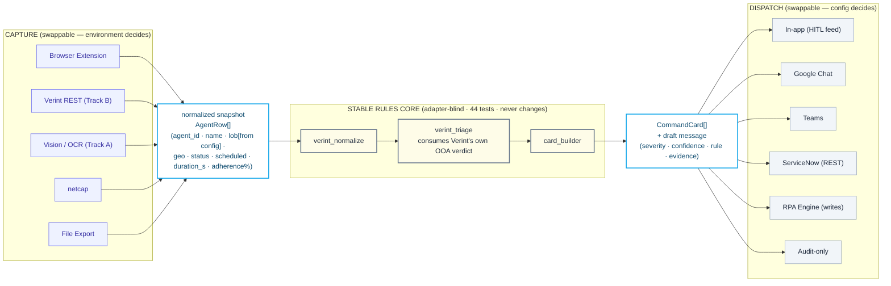
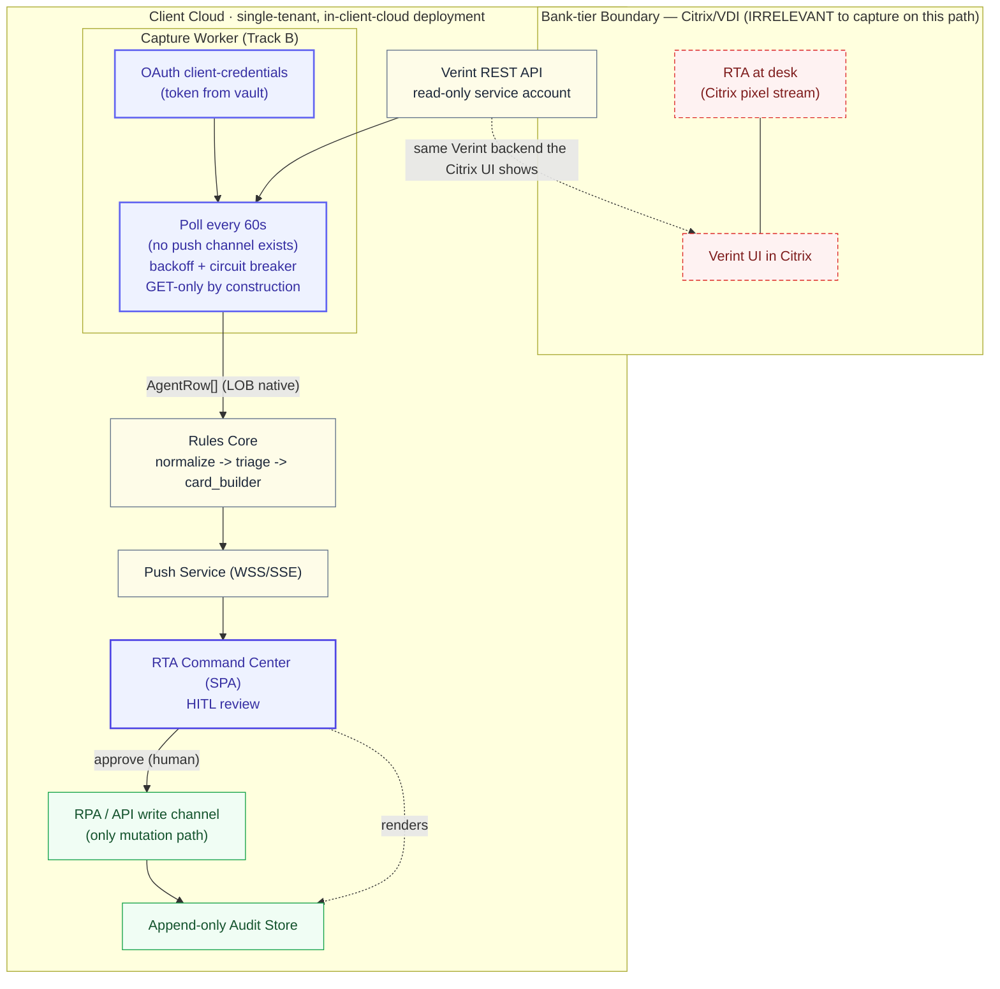
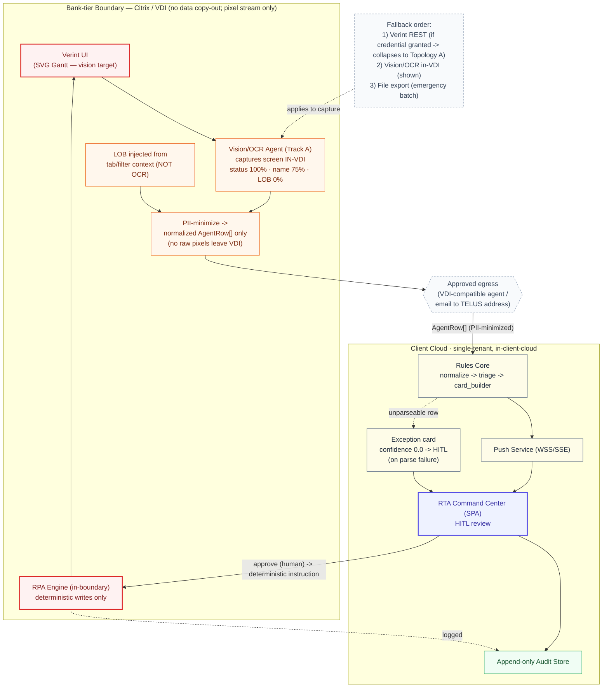
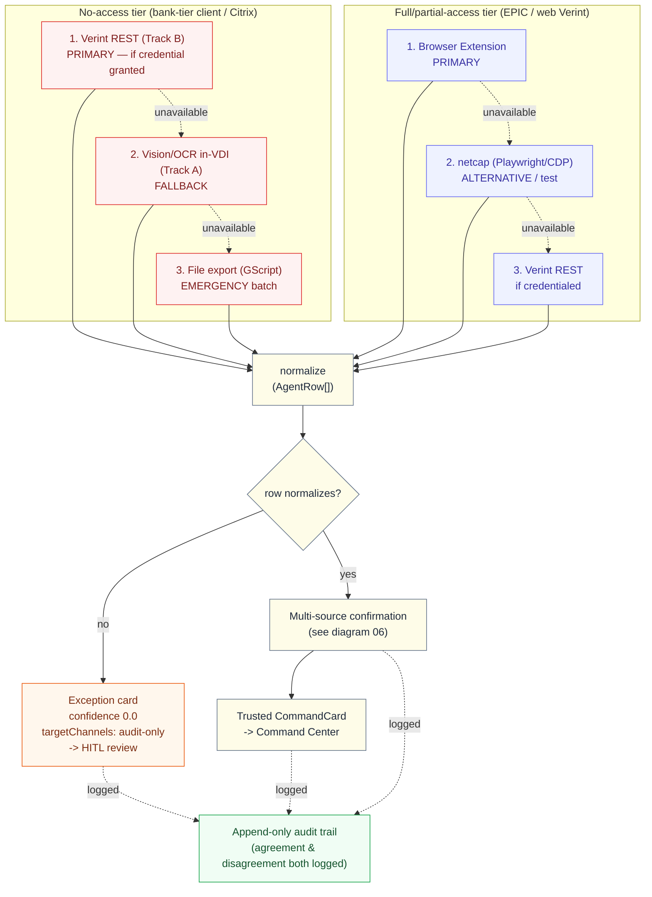
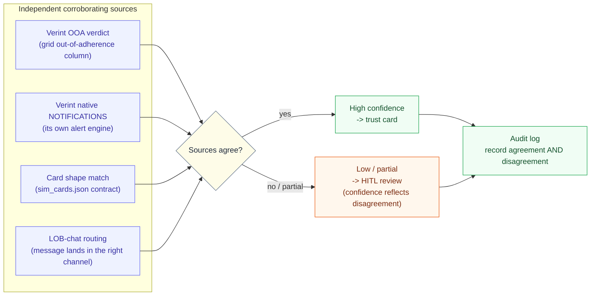

*Audience: integration engineers. Purpose: the complete catalog of capture and dispatch connectors, the two integration topologies (read-only REST vs Citrix/VDI), and how the connectors compose as fail-prevention. Extends [../CAPTURE_AND_DISPATCH_ADAPTERS.md](../CAPTURE_AND_DISPATCH_ADAPTERS.md) (the adapter model) and [../CONNECTOR_SCENARIOS.md](../CONNECTOR_SCENARIOS.md) (which adapter per environment).*

---

# Connector Catalog

## 1. The adapter contract

Every **capture** adapter, regardless of how it reaches Verint, emits the same normalized `AgentRow[]`. Every **dispatch** adapter consumes the same `CommandCard`. The rules core in between is **adapter-blind** and never changes — see the spine in [SYSTEM_ARCHITECTURE.md §2](./SYSTEM_ARCHITECTURE.md).



*Diagram source: [02-adapter-spine.mmd](./diagrams/mmd/02-adapter-spine.mmd)*

`AgentRow` (the capture→core seam):

```
agent_id          stable per agent (deterministic hash when no native id)
agent_name        as displayed in Verint
lob               FROM CONFIGURATION, never from OCR   ← see §3 OCR baseline
geo               Guatemala | Philippines | Unknown
actual_status     Verint status code (e.g. COAC, INBD)
scheduled_activity what the schedule says
duration_seconds  time in current status
adherence_pct     0–100
```

A non-negotiable rule surfaces immediately: **`lob` is injected from the active Verint tab/filter context or routing metadata, never read off the screen.** The OCR baseline measured LOB recognition at **0%** (§3); routing on a mis-read LOB would send an alert to the wrong line of business.

## 2. Status legend

| Symbol | Meaning |
|---|---|
| ✅ | Built and proven |
| ⚠️ | Baseline measured; not production-ready |
| 🔓 | Designed; needs a credential or a build |

## 3. Capture adapter catalog

| Adapter | How it works | Environment | Status | PII posture |
|---|---|---|---|---|
| **Browser Extension** (RTA Live Bridge) | MV3 extension hooks Verint's own `fetch`/XHR in the RTA's browser, parses `calendar-filter`, bridges cards to the Command Center via `postMessage`. | Web-accessible Verint ("just a browser" — EPIC). **Does not work in Citrix.** | ✅ Live-proven on EPIC (12 real cards, 2026-06-05). | PII stays in the local browser (same-machine); a networked relay needs an explicit PII decision (§7). |
| **netcap** (Playwright/CDP) | Drives/observes a browser headlessly, records the API JSON deterministically. | Web Verint; dev/test/CI; repeatable capture. | ✅ Proven on real EPIC data. | Local capture; treat recordings as transient PII. |
| **Vision/OCR** (Track A) | Screenshot of the Verint window → OCR/vision engine → structured rows. | **Citrix/VDI pixel stream — the only local option there.** Must run *inside* the VDI. | ⚠️ Baseline: status **100%**, name **75%**, duration **75%**, **LOB 0%**. Needs a classifier fine-tuned on 200–500 labeled bank-tier-client screens. | Capture in-VDI; **only PII-minimized normalized rows leave** — never raw pixels. |
| **Verint REST API** (Track B) | Backend calls Verint's adherence API server-to-server (OAuth client-credentials), no UI. | Both — **the bank-tier-client unlock**: bypasses Citrix entirely. | 🔓 Designed; needs a read-only credential. | No pixels, no OCR; LOB comes natively from the API. |
| **File Export** (GScript) | Scheduled Verint export → file → backend ingest. | Both; legacy/batch. | 🔓 Designed; not built. | File-based; highest latency and operational friction. |

> **Vision/OCR is *not* general "computer-use" AI.** The Track A adapter is a constrained, **read-only extraction** step (screenshot → structured rows, run inside the VDI). Autonomous computer-use agents (driving the UI) are **exploration-only, not production-ready, and outside the production governance envelope** — never a write path. See [SYSTEM_ARCHITECTURE.md §7](./SYSTEM_ARCHITECTURE.md).

**Verint endpoints** the capture adapters consume (documented as upstream contracts we don't own):
- `/api/wfm/main/v2/calendar-filter` — schedule + adherence; companions `calendar-events-bulk`, `event-conflict`, `find-shiftworkrules`, `find-shift-ot-extensions`; ~50 rows/page, paginated; **no WebSocket** (refresh is interaction-driven — see [../OBSERVABILITY_DRY_RUN.md](../OBSERVABILITY_DRY_RUN.md)).
- `/api/wfm/main/v1/work-resources` — id→name. `/api/wfm/main/v1/activities` — id→activity name.
- Track B real-time adherence (version-dependent), e.g. `GET /api/v1/realtime/adherence`, OAuth client-credentials; LOB available natively (`groupName`/`organizationalUnitName`). Field mapping detail: [../HARNESS_FOR_COMPUTER_USE_HOWTO.md](../HARNESS_FOR_COMPUTER_USE_HOWTO.md) §4.

## 4. Dispatch adapter catalog

| Adapter | How it works | Status | Notes |
|---|---|---|---|
| **In-app** | Card surfaces in the Command Center feed with a draft; RTA reviews. | ✅ | Always present — the HITL layer. Not a dispatch, a review. |
| **Google Chat** (per-LOB) | Backend POSTs to the LOB's Incoming Webhook on RTA approval; outcome to audit. | 🔓 | The real RTA workflow target. Webhook URLs are secrets (vault, never frontend). `TargetChannel: "google-chat-lob"`. |
| **Microsoft Teams** | Same pattern via Bot Framework / Incoming Webhook. | 🔓 | Alternate/supervisor channel. `TargetChannel: "teams-workforce"`. |
| **ServiceNow** (REST) | Backend POSTs `/api/now/table/incident`; stores `INC-XXXXX` in audit. | 🔓 | **REST, not MCP** — see [../SERVICENOW_MCP_EVALUATION.md](../SERVICENOW_MCP_EVALUATION.md). `TargetChannel: "servicenow"`. |
| **Audit-only** | Logs to the audit trail; sends nothing externally. | ✅ | For suppressed/review-only cards. `TargetChannel: "audit-only"`. |
| **RPA Engine** (UiPath) | Deterministic UI bot, runs inside the Verint/Citrix boundary; executes approved writes. | 🔓 | **The only approved write channel into Verint.** Deterministic steps only — never judgment. |

The `TargetChannel` enum is defined in [../../command-center/src/domain/types.ts](../../command-center/src/domain/types.ts) and mirrored in dispatch entries ([scenario_types.ts](../../command-center/src/domain/scenario_types.ts)).

## 5. The two integration topologies

The single most important capture decision for any client is **how Verint is reached**. That decision selects one of two topologies; everything downstream (normalize → core → cards → Command Center → dispatch) is identical.

### Topology A — Read-only Verint REST API (the preferred bank-tier-client path)



*Diagram source: [03-integration-rest-readonly.mmd](./diagrams/mmd/03-integration-rest-readonly.mmd)*

A backend capture worker, deployed in the client's cloud, calls Verint's read-only REST API server-to-server. **The Citrix/VDI boundary becomes irrelevant to capture** — there are no screenshots, no OCR, no pixel egress, and LOB arrives natively. This "collapses the hard case into the easy case" and is **the single highest-leverage access grant to pursue with a bank-tier client** ([../CONNECTOR_SCENARIOS.md](../CONNECTOR_SCENARIOS.md)).

Design points:
- **Poll every 60s.** There is no push channel (no WebSocket; refresh is interaction-driven per [../OBSERVABILITY_DRY_RUN.md](../OBSERVABILITY_DRY_RUN.md)), so the backend generates its own cadence. 60s sits comfortably inside the 15-minute RTA cycle; floor at 30s (smallest business threshold is the 3-minute hold — sub-minute is noise).
- **Backoff + circuit breaker** on `429`/`5xx`; never tighter than the 60s floor on success. An open breaker surfaces a visible "capture degraded" state and emits an audit event (a data gap is itself auditable).
- **GET-only by construction** — the capture credential is a read-only service account scoped to adherence/schedule reads; it physically cannot write.

### Topology B — Citrix/VDI-limited (no API credential granted)



*Diagram source: [04-integration-citrix-vdi.mmd](./diagrams/mmd/04-integration-citrix-vdi.mmd)*

When Verint is reachable only as a Citrix pixel stream and no REST credential exists, capture must happen **inside the VDI** (the browser extension cannot work — there is no local DOM/fetch). A vision/OCR agent captures the screen in-VDI, injects LOB from tab context, PII-minimizes to normalized rows, and only those rows leave via an approved egress (a VDI-compatible agent or email to a TELUS address — raw pixels never leave). Writes go only through an **RPA engine that runs inside the boundary**.

Constraints that make this the hard path: OCR LOB at 0% (LOB from config, mandatory), fragile table reconstruction, a classifier that needs 200–500 labeled bank-tier-client screens, and the strict no-copy-out VDI rule ([../HARNESS_FOR_COMPUTER_USE_HOWTO.md](../HARNESS_FOR_COMPUTER_USE_HOWTO.md)).

## 6. The fail-prevention model (the heart of the catalog)

Capture depends on an upstream we don't own, so the system is built to **degrade, corroborate, and escalate** rather than fail silently. Four layers:



*Diagram source: [05-connector-failprevention.mmd](./diagrams/mmd/05-connector-failprevention.mmd)*

1. **Primary → fallback layering, per environment.** The chosen primary degrades to a fallback when unavailable — and the *order is configuration* (the capture list in the tenant manifest, [FDAE_CONFIGURATION_LAYER.md](./FDAE_CONFIGURATION_LAYER.md)):
   - **`none`-access (bank-tier client / Citrix):** Verint REST (once credentialed) → Vision/OCR in-VDI → file export.
   - **`full`/`partial`-access (EPIC / web):** browser extension → netcap → Verint REST.
2. **Multi-source confirmation matrix.** A flagged agent is "confirmed" when independent sources agree: Verint's own out-of-adherence verdict + Verint's native NOTIFICATIONS + the card-shape match + the LOB-chat routing. Agreement *and* disagreement are both logged; disagreement lowers confidence and can divert to HITL.



*Diagram source: [06-multisource-confirmation.mmd](./diagrams/mmd/06-multisource-confirmation.mmd)*
3. **Exception cards.** When a row cannot be normalized, the core emits a `type: "exception"` card with `confidence: 0.0` and `targetChannels: ["audit-only"]`, routed to HITL review. A real, unparseable input is surfaced, never dropped.
4. **Append-only audit trail.** Every capture outcome, confirmation result, and dispatch is written immutably (see [DATA_GOVERNANCE_AND_MULTITENANCY.md](./DATA_GOVERNANCE_AND_MULTITENANCY.md)).

## 7. Capture-path PII & the relay decision

- **Same-browser extension:** PII never leaves the machine — the proven, PII-clean default for single-RTA setups.
- **Backend relay (multi-RTA / centrally hosted):** the extension POSTs to `/api/ingest` over WSS with the RTA's short-lived token; cards then fan out to subscribed Command Centers. This requires a deliberate PII decision — either minimize-then-send (IDs + status codes, resolve names server-side) or send-under-agreement. For in-client-cloud deployments this is a governance gate, not just an engineering one.
- **In-VDI vision:** only PII-minimized normalized rows cross the boundary; raw pixels never do.

## 8. MCP / RPA composition (brain vs hands)

- **The LLM is the brain:** it perceives and judges the ambiguous parts (RPA is forbidden from judgment). It only advises/drafts.
- **RPA/API are the hands:** they execute deterministic, auditable, system-touching steps — the certified write channel.
- **MCP is never a parallel write path.** When the brain decides "open a ticket" or "correct a schedule," it delegates to RPA/API; it never pokes the target UI itself. Two composition topologies exist (MCP-over-RPA; RPA-calls-AI), both keeping writes deterministic and audited. Source: [../VERINT_MCP_AND_RPA_NOTE.md](../VERINT_MCP_AND_RPA_NOTE.md).

This is the connector-level expression of the governance invariant in [SYSTEM_ARCHITECTURE.md §7](./SYSTEM_ARCHITECTURE.md): **the audit query "any write where `actor = ai`" returns zero rows.**

## 9. Generalization beyond Verint

The same capture→normalize→core→dispatch shape extends to other source systems by adding capture adapters that emit the normalized snapshot and dispatch adapters that consume `CommandCard`:
- **ServiceNow / NICE / Workday / GTT** as same-shape capture (attendance, tickets, telecom login) — see [../FUTURE_FEATURES.md](../FUTURE_FEATURES.md).
- Each new system is a registry entry (a connector type with a config schema and capability flags), selected per client in the tenant manifest — it does not change the core.
