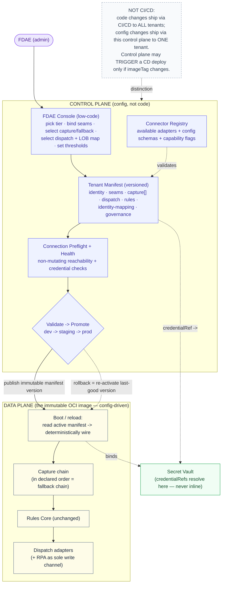

*Audience: platform engineers + FDAE admins. Purpose: the control plane that configures the swappable adapters per client — the "select the systems present, know which connections to expect" layer. This is a **starter**: the model, the tenant-manifest shape, and the lifecycle are defined; the console UX is sketched, not finalized. Anchored to [../FDAE_Program_Response_Derek_Erin.md](../FDAE_Program_Response_Derek_Erin.md) and [../NEXT_STEPS.md](../NEXT_STEPS.md) Priority 3.*

---

# FDAE Configuration Layer

## 1. Framing — what this is, and what it is NOT

An **FDAE** stands up the product for a new client: they decide which systems are present, wire the connectors, and tune the rules. Today that means hand-editing JSON/TS and redeploying. This layer replaces that with a **control plane + low-code integration configurator**.

Get the vocabulary right, because the wrong word misleads the build:

| | Control plane (this layer) | CI/CD |
|---|---|---|
| Ships | per-client **configuration** | **code** (one image for everyone) |
| Affects | **one tenant** | **all tenants** |
| Needs a build? | No | Yes (full test suite) |
| Rollback | re-activate previous manifest (seconds) | redeploy a previous image |

> This is **not** CI/CD. The container image is immutable; only configuration changes. The control plane *may trigger* a CD deploy when (and only when) a config change also bumps the image tag — that is the single, one-directional coupling. Keep the two pipelines separate: a bank-tier client's threshold tweak must never be able to break EPIC.

This realizes the existing commitment in [../NEXT_STEPS.md](../NEXT_STEPS.md): *"codebase unchanged per account; only config changes."*



*Diagram source: [10-fdae-control-vs-data-plane.mmd](./diagrams/mmd/10-fdae-control-vs-data-plane.mmd)*

## 2. The tenant manifest — the central artifact

One declarative, versioned document per client per environment that **fully determines a deployment**. It consolidates and replaces today's hardcoded config (`lob_channel_map.json`, `alert_thresholds.json`, `channelConfig.ts`, `constants.ts`). Conceptual shape (to be formalized as a JSON Schema in the deferred API spec):

```jsonc
{
  "tenantId": "banktier",
  "displayName": "Bank-tier Client GT/PH",
  "environment": "prod",
  "version": 14,                       // monotonic; every save increments
  "accessTier": "none",                // full | partial | none  -> drives capture strategy
  "deployment": "in-client-cloud",     // in-client-cloud | vendor-hosted  -> topology (D1)

  // D2 — the five cloud-neutral seams, each a binding (credential by reference)
  "seams": {
    "vault":       { "provider": "...", "endpoint": "...", "credentialRef": "..." },
    "opStore":     { "provider": "...", "endpoint": "..." },
    "intelStore":  { "provider": "...", "endpoint": "..." },
    "llm":         { "provider": "...", "endpoint": "...", "credentialRef": "..." },
    "runtime":     { "provider": "...", "region": "ca-central" }   // data residency
  },

  // CAPTURE — ordered list; THE ORDER IS THE FALLBACK CHAIN
  "capture": [
    { "adapter": "verint_rest",   "frequencySeconds": 60, "credentialRef": "secrets://banktier/verint", "enabled": true },
    { "adapter": "vision_ocr",    "constraint": "in-vdi-only", "enabled": true },
    { "adapter": "gscript",       "enabled": false }
  ],

  // DISPATCH — enabled adapters + LOB->channel map (replaces the hardcoded map)
  "dispatch": {
    "channels": {
      "google-chat-lob": { "provider": "google-chat", "credentialRef": "secrets://banktier/gchat" },
      "servicenow":      { "provider": "servicenow",  "credentialRef": "secrets://banktier/snow" }
    },
    "lobMap": [ { "lob": "TLB", "geo": "Guatemala", "channel": "google-chat-lob", "spaceRef": "secrets://banktier/gchat/tlb" } ],
    "fallbackChannel": "google-chat-lob",
    "writeChannel": "rpa"              // the ONLY mutation path
  },

  // RULES — the pluggable engine (from shared/constants.ts, made data-driven)
  "rules": {
    "cycleMinutes": 15,
    "thresholds": { "longCallSeconds": 540, "longHoldSeconds": 180 },
    "lobFromConfig": true,            // never derive LOB from OCR
    "triageMode": "consume-verint-verdict"
  },

  // identity mapping — the shared join key (FUTURE_FEATURES.md)
  "identityMapping": { "verintId": "...", "workdayId": "...", "surrogateKeyAlgo": "hmac-per-tenant" },

  // governance
  "governance": {
    "retention": { "operationalDays": 365, "intelligenceMonths": 84 },
    "piiTokenization": "required",
    "benchmarkingOptIn": false        // default off, legal-gated (D3)
  }
}
```

**Determinism is the point:** at boot (or manifest reload) the image reads exactly one manifest and wires itself — instantiates only the capture adapters in `capture[]` (in order), only the dispatch channels in `dispatch.channels`, loads `rules` into the engine, binds the five seams. A bank-tier client and EPIC run the *same image* with *different manifests*. Same image + same manifest → same wiring (auditable; safe rollback).

## 3. The connector registry

The catalog of every adapter the image ships with — the data-plane-agnostic source the manifest selects from. Each registry entry declares:
- **type** (`capture` | `dispatch`) and **id** (`verint_rest`, `vision_ocr`, `browser_extension`, `google_chat`, `servicenow`, `rpa`, …),
- a **config schema** (what fields the manifest must supply),
- **capability flags**: `writeChannel?`, `piiPosture`, and **environment constraints** (e.g. `in-vdi-only`, `needs-readonly-credential`, `web-only`).

The manifest's `capture`/`dispatch` entries must validate against the registry — this is what lets the console gate impossible choices (a `none`-access/Citrix client never sees `browser_extension` offered). The registry is the machine-readable form of the [CONNECTOR_CATALOG.md](./CONNECTOR_CATALOG.md) matrix.

## 4. Connection preflight & health

The "faster iteration for testing and adjustments" the FDAE wants is a **per-connector dry-run**:

- **Preflight (before promotion):** each selected connector runs a **non-mutating** reachability + credential check, respecting the no-egress / no-write rules:
  - `verint_rest` → authenticated read-only `GET` (count rows, **show no PII**).
  - `browser_extension` → bridge-presence check.
  - `vision_ocr` → in-VDI agent handshake.
  - dispatch (`google_chat`/`servicenow`) → webhook/endpoint reachability (validate without posting, or post to a designated test space).
- **Health status vocabulary:** `connected` · `auth-failed` · `unreachable` · `not-configured` · `degraded` (reachable but a capability check failed — e.g. REST up but `calendar-filter` 403s).
- **Continuous health:** an active adapter that fails trips the **fallback chain** (the next entry in `capture[]`) and raises an operational signal. (Reuses the `HealthStrip` traffic-light pattern from the SPA, applied to connectors instead of KPIs.)

## 5. Validation → promotion → rollback

The config lifecycle, deliberately distinct from code CI/CD:

1. **Validate** — schema-validate the manifest against the registry and enforce invariants:
   - exactly **one** write channel, and it is RPA/API (never AI);
   - `accessTier` + `deployment` set; every `seams.*.credentialRef` resolves in the vault; **no inline secrets**;
   - every `dispatch.lobMap[].channel` exists in `dispatch.channels`; `fallbackChannel` is enabled;
   - `rules.lobFromConfig` is true (LOB never from OCR).
2. **Preflight** — run §4 checks in the target environment.
3. **Promote** dev → staging → prod — each gate requires validation + preflight to pass; promotion publishes a new **immutable** manifest version. The image does not change. (A staging/prod promotion is blocked if any connector is `auth-failed`/`unreachable`; dev allows broken connectors — that's where the FDAE iterates.)
4. **Dry-run replay** (recommended pre-promotion gate) — run the manifest against a captured fixture ([../../fixtures/verint_capture_sample.json](../../fixtures/verint_capture_sample.json) or a `runs/` capture) through the *real* rules core and assert it produces cards without error. Reuses the existing 44-test core unchanged.
5. **Rollback** — re-activate the previous manifest version; the running image re-reads config and re-wires. Instant and deterministic for pure-config changes; a CD redeploy only if `deploy.imageTag` also changed.

## 6. The FDAE console (UX sketch — to be finalized)

A low-code, admin-gated surface in the SPA, built on the existing `CaptureConfigModal` interaction model (chips + status badges) promoted from a per-session picker to a per-tenant workspace:

1. **Tenant + environment** selector (shows active manifest version).
2. **"Systems present at this client"** grid — toggle WFM tool / ticketing / chat / attendance; the console derives required connectors + credentials from the registry and gates impossible methods by `accessTier`/`constraint`.
3. **Connection health panel** — a status chip + **"Test connection"** per connector (§4).
4. **Config editor** — no-code LOB→channel map, thresholds, SL gates.
5. **Promote / rollback** controls with the validation + preflight gates.

This section is intentionally a sketch — it is the **starting point** for the next working session, which will turn the manifest schema, the registry, and the preflight contract into concrete designs (and is the natural home for the deferred [API_SPECIFICATION.md](./API_SPECIFICATION.md), since the control-plane REST surface is defined here).

## 7. What this reuses (no greenfield)

- `command-center/src/components/CaptureConfigModal.tsx` — the connector-registry seed + the systems grid.
- `command-center/src/shared/channelConfig.ts` — rendering layer for `dispatch.channels`.
- `command-center/src/components/HealthStrip.tsx` — the connection-health panel pattern.
- `POC/07_simulation/data/lob_channel_map.json`, `POC/01_evidence_pack/rules/alert_thresholds.json`, `command-center/src/shared/constants.ts` — the exact shapes that become `dispatch.lobMap` and `rules`.
- The rules core (`verint_normalize`/`verint_triage`/`card_builder`) — unchanged; only *where config comes from* changes (manifest, not disk).
