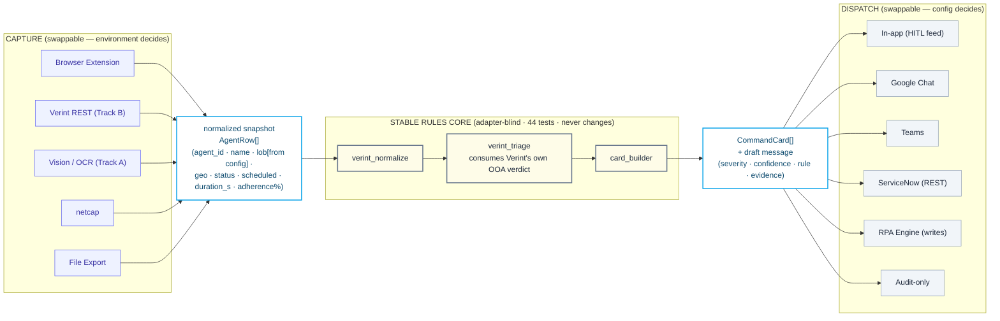
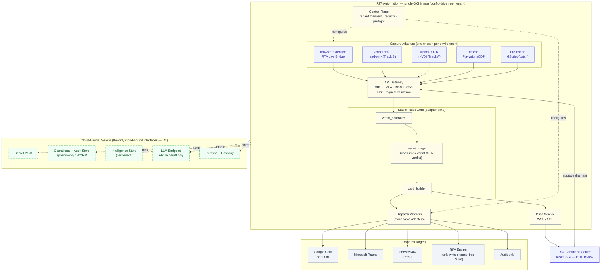

*Audience: architects + senior engineers. Purpose: the production architecture of the RTA Automation product and the invariants every other document depends on. This is the production successor to [../ARCHITECTURE.md](../ARCHITECTURE.md), which remains the POC-as-built record.*

---

# System Architecture

## 1. Relationship to the POC

[../ARCHITECTURE.md](../ARCHITECTURE.md) describes the POC: a React + Vite SPA with **no backend**, all state in the browser, the LLM called directly from the client, and the Verint capture proven via a same-browser extension. That POC validated the hard parts — that we can read Verint read-only, normalize it deterministically, and render reviewable cards. This document describes what that becomes in production: a backend-fronted, multi-client, deployable system that preserves the POC's proven core unchanged.

**What stays:** the rules core (`verint_normalize → verint_triage → card_builder`, 44 tests) and the `CommandCard` domain model ([../../command-center/src/domain/types.ts](../../command-center/src/domain/types.ts)).
**What is new:** a backend (API gateway, push service, dispatch workers, control plane), persistence, identity, and the deployment model.

## 2. The architectural spine

The system is a pipeline with two swappable ends and a fixed middle:

> **swappable CAPTURE adapters → stable rules core → swappable DISPATCH adapters**

*Diagram source: [02-adapter-spine.mmd](./diagrams/mmd/02-adapter-spine.mmd)*

The load-bearing invariant: **every capture adapter emits the same normalized snapshot (`AgentRow[]`), and the core is adapter-blind.** Whether the data arrived via the browser extension, a read-only REST call, an in-VDI vision agent, netcap, or a file export, the core sees one shape and produces `CommandCard[]` identically. Likewise every dispatch adapter consumes the same `CommandCard`. This is why one product can serve a no-access, Citrix-locked bank and a full-access web-Verint shop without forking the code — see [CONNECTOR_CATALOG.md](./CONNECTOR_CATALOG.md).

The `AgentRow` contract (the seam between any capture adapter and the core):

| Field | Notes |
|---|---|
| `agent_id` | stable per agent (deterministic hash when no native id) |
| `agent_name` | as displayed in Verint |
| `lob` | **from configuration, never from OCR** (OCR LOB accuracy is 0% — see Connector Catalog) |
| `geo` | `Guatemala` / `Philippines` / `Unknown` |
| `actual_status` | Verint status code (e.g. `COAC`, `INBD`) |
| `scheduled_activity` | what the schedule says |
| `duration_seconds` | time in current status |
| `adherence_pct` | 0–100 |

The core's output is the `CommandCard` ([types.ts](../../command-center/src/domain/types.ts)) — the single unit of work for every alert, task, report, exception, escalation, coaching decision, and outage playbook.

## 3. The five cloud-neutral seams (D2)

The product is **cloud-agnostic**: it binds to a cloud at exactly five interfaces, each behind an abstraction with per-cloud adapters. Everything else is cloud-neutral application code packaged in one OCI image.

*Diagram source: [01-system-architecture-cloud-neutral.mmd](./diagrams/mmd/01-system-architecture-cloud-neutral.mmd)*

| Seam | Responsibility | Example bindings (reference only) |
|---|---|---|
| **Secret Vault** | All credentials — Verint read account, dispatch webhooks, LLM key, OIDC secret. Never in the image, never in `VITE_` vars. | Azure Key Vault · AWS Secrets Manager · GCP Secret Manager · HashiCorp Vault |
| **Operational + Audit Store** | Live cards, dispatch log, **append-only/WORM audit trail**. | Cosmos DB · DynamoDB · Firestore · Postgres + object-lock |
| **Intelligence Store** | Derived analytics (adherence trends, attendance, attrition), **per-tenant isolated** (D3). | a warehouse/lakehouse per tenant |
| **LLM Endpoint** | The model the Copilot calls — **advise/draft only**, reached via backend proxy. | in-tenant Azure OpenAI · Vertex · Bedrock · self-hosted · FuelIX via egress proxy |
| **Runtime + Gateway** | Where the image runs and how ingress is fronted. | Azure Container Apps · Cloud Run · ECS · AKS/GKE/EKS |

The **OCI container image is the portability layer.** Moving clouds is a deploy decision (swap the seam bindings), not a rewrite. Provider-specific deployment detail lives in [DEPLOYMENT_AND_OPERATIONS.md](./DEPLOYMENT_AND_OPERATIONS.md); diagrams stay cloud-neutral (the project's cloud-agnostic diagram policy).

## 4. One image: three access tiers, two deployment topologies (D1)

A single image serves every client. Two independent axes decide *how* — both carried in the tenant manifest (see [FDAE_CONFIGURATION_LAYER.md](./FDAE_CONFIGURATION_LAYER.md)):

**Access tier** — how much access we have to the client's WFM system (the primary client-segmentation axis, per the platform strategy):
- **`full`** — we own/administer the tech or have full API access (e.g. Google). Capture server-side via REST; richest, lowest-friction.
- **`partial`** — web-accessible but without a full API (e.g. EPIC's web Verint). Capture via the browser extension / netcap plus whatever API exists.
- **`none`** — pixel-only through Citrix/VDI, no API, no local DOM (e.g. a bank-tier client). Capture via an in-VDI vision/OCR agent — or pursue a read-only API credential, which *upgrades the tier* and collapses the hard case (see [CONNECTOR_CATALOG.md](./CONNECTOR_CATALOG.md)).

**Deployment topology** — where the stack runs (a separate axis, correlated with but not identical to access tier):
- **in-client-cloud** — the whole stack deploys *into the client's own cloud/VPC*, single-tenant, behind their identity and network controls; the vendor retains nothing in the runtime data path. Required for restricted/regulated clients (e.g. a bank).
- **vendor-hosted** — runs on vendor infrastructure, isolated per tenant. For permissive clients.

The axes combine: a bank-tier client = `none`-access + in-client-cloud; a `full`-access web shop can be vendor-hosted. The manifest carries both (`accessTier` + `deployment`) and self-configures the identical image: which capture adapters to instantiate (and in what fallback order), which dispatch adapters, the LOB→channel map, rule thresholds, and the seam bindings. "One codebase, many clients" — no per-client forks.

## 5. Production component model

| Component | Responsibility | Replaces in POC |
|---|---|---|
| **SPA (Command Center)** | HITL review surface; renders cards, copilot, dispatch feed, learning strip. | unchanged UI; data source swaps from simulation to live push |
| **API Gateway** | Single ingress: OIDC token validation, MFA enforcement, RBAC, rate-limiting, request validation against the contract, mTLS to services. | nothing (no backend in POC) |
| **Capture workers** | Run the chosen capture adapter(s); produce `AgentRow[]`. | the same-browser extension path |
| **Rules-core service** | `verint_normalize → verint_triage → card_builder`; the unchanged core, wrapped as a service. | the JS twin (`parse.js`) + Python core — unified here |
| **Dispatch workers** | One worker per dispatch adapter, config-selected. | the label-only channels in the demo |
| **Push service** | Streams `CardEvent`s to subscribed SPAs over WSS/SSE. | `useExtensionBridge` postMessage / `useLiveEngine` simulation |
| **Control plane** | Holds the tenant manifest + connector registry; runs preflight; configures the data plane. | hardcoded config files |

## 6. Production data flow

1. A **capture worker** reads Verint (REST / extension-relay / in-VDI vision / file) and emits `AgentRow[]`.
2. The **rules-core service** normalizes → triages (consuming Verint's own out-of-adherence verdict) → builds `CommandCard[]` with severity, confidence, rule provenance, and a drafted message.
3. Cards are written to the **operational store** and streamed via the **push service** to the SPA.
4. The **RTA reviews** (HITL): approve / edit / suppress / escalate. Approval calls back through the gateway.
5. A **dispatch worker** delivers the message to the selected `TargetChannel`; the outcome is written to the **append-only audit trail**.
6. The **RTA's decision** becomes a `LearningSignal` ([types.ts](../../command-center/src/domain/types.ts)) for the learning loop.

This replaces the POC's `useLiveEngine` simulation loop with a real capture→core→push→review→dispatch flow.

## 7. The governance invariant (non-negotiable)

> **No AI write path exists.** The LLM only *advises* and *drafts*. Every mutation of an external system (Verint schedule correction, ServiceNow ticket, chat send) is executed by a **human** or by a **deterministic RPA/API channel** — never by the model.

This is enforced structurally and provably:
- The LLM-facing code holds **no write credential** to any target system; it can only call the LLM endpoint, which returns text.
- Every write event carries `actor ∈ { "rta", "system" }` plus, for RPA, an explicit deterministic-bot identity. The `AuditEvent.actor` type ([types.ts](../../command-center/src/domain/types.ts)) is `"ai" | "rta" | "system"` today; production adds the RPA actor and a `decisionSource` (human / AI-advisory / RPA-deterministic).
- **The compliance proof is an empty result set:** a reviewer querying the audit store for *"any write where `actor = ai`"* gets **zero rows**.

**Computer-use AI is explicitly outside the production governance envelope.** Autonomous browser/computer-use agents (driving a UI) are for *exploration only* — not production-ready — are never granted a write path, and are not part of the certified deterministic write channel. The capture-side vision/OCR fallback is a constrained, read-only extraction step (see [CONNECTOR_CATALOG.md](./CONNECTOR_CATALOG.md)), not general computer-use.

Background: [../VERINT_MCP_AND_RPA_NOTE.md](../VERINT_MCP_AND_RPA_NOTE.md) (brain-vs-hands; MCP is never a parallel write path) and [../SERVICENOW_MCP_EVALUATION.md](../SERVICENOW_MCP_EVALUATION.md) (dispatch is a thin deterministic REST connector, not an MCP server).

## 8. Failure domains and graceful degradation

Capture is the riskiest domain (it depends on an upstream we don't own). The system degrades along a **per-environment fallback chain** rather than failing hard:

- **`none`-access / Citrix (bank-tier client):** Verint REST (primary, once a read-only credential is granted) → Vision/OCR in-VDI (fallback) → file export (emergency).
- **`full`/`partial`-access / web (EPIC):** browser extension (primary) → netcap (alternative) → REST (if credentialed).

When a row cannot be normalized, the core emits an **exception card** (`type: "exception"`, `confidence: 0.0`, `targetChannels: ["audit-only"]`) routed to HITL review — a real, unparseable input never silently vanishes. Full fail-prevention model: [CONNECTOR_CATALOG.md](./CONNECTOR_CATALOG.md).

## 9. Scaling model

- **Isolation first (D3):** each client is a separate tenant with isolated stores; for in-client-cloud deployments, a separate stack in the client's cloud. No cross-tenant data path exists in this phase.
- **Horizontal scale within a tenant:** capture workers, dispatch workers, and the rules-core service are stateless and scale out; the push service scales by connection count; the stores scale per their cloud binding.
- **Kubernetes is deferred:** a single-tenant stack is a handful of stateless services + stores + a push hub — managed-runtime territory. Adopt an orchestrator only at multi-client density or when a client mandates it. The image doesn't change; only the runtime seam does. See [DEPLOYMENT_AND_OPERATIONS.md](./DEPLOYMENT_AND_OPERATIONS.md).

## 10. Cross-references

- **Connectors & integration topologies:** [CONNECTOR_CATALOG.md](./CONNECTOR_CATALOG.md)
- **Per-client configuration (the manifest):** [FDAE_CONFIGURATION_LAYER.md](./FDAE_CONFIGURATION_LAYER.md)
- **Identity, OAuth2/OIDC, MFA, gateway, secrets, threat model:** [SECURITY_ARCHITECTURE.md](./SECURITY_ARCHITECTURE.md)
- **Isolation tiers, the three-store model, PII, retention:** [DATA_GOVERNANCE_AND_MULTITENANCY.md](./DATA_GOVERNANCE_AND_MULTITENANCY.md)
- **Deploy, blue/green, observability:** [DEPLOYMENT_AND_OPERATIONS.md](./DEPLOYMENT_AND_OPERATIONS.md)
- **The contract:** [API_SPECIFICATION.md](./API_SPECIFICATION.md) (deferred)
- **Features & requirements:** [PRD.md](./PRD.md)
